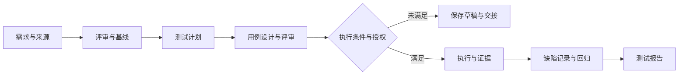

<div align="center">

# QA Master Skill

**把需求变成可追踪的测试工作：从评审、计划和用例，到授权执行、缺陷回归与报告。**

[](pyproject.toml)
[](https://github.com/leongibhub/QA-Master-Skill/actions/workflows/test.yml)
[](LICENSE)

[快速开始](#快速开始) · [使用示例](#按你需要的范围工作) · [完整技能目录](docs/SKILL_CATALOG.md) · [操作指南](docs/GETTING_STARTED.md) · [验证记录](docs/verification/)

</div>

## 你可以用它完成什么

给 QA Master 一份需求、代码仓库或接口说明，再说明你需要的交付物。它通过 Agent 阅读来源、选择专业指南、形成测试产物；本地工具负责状态保存、规则路由、确定性设计与证据校验。开发尚未完成时，可以先完成评审和设计，保存交接信息后继续。

| 你的任务 | 交付物 | 适用例子 |
| --- | --- | --- |
| 看懂需求、识别风险 | 冲突清单、待确认问题、可测试条件 | 多份需求不一致、验收标准不明确 |
| 制定测试计划 | 范围、优先级、环境与数据需求、退出条件 | 新版本测试、接口改造、系统集成 |
| 编写和评审用例 | 前置条件、步骤、预期结果、来源追踪、覆盖缺口 | 功能、API、状态机、权限、异常路径 |
| 选择专项测试方法 | 相关指南、测试策略与可审查草稿 | Web UI、性能、安全、AI/RAG、混沌测试 |
| 执行、跟踪与回归 | 获授权的执行记录、缺陷材料、回归范围、证据报告 | 已有可测版本、明确环境和执行权限 |
| 跨会话继续工作 | 当前阶段、未决问题、暂停原因与下一步 | 等待构建、等待需求澄清、分阶段交付 |

**单独做一个阶段、组合多个阶段或规划完整流程，都使用同一个入口。** 企业系统接入可选；需求评审和本地设计无需 Jira、GitLab 或测试机。

## 快速开始

需要 Python 3.10+、Git，以及支持加载 Skill 的 Agent。下面使用项目级 Codex 安装，避免修改全局技能目录。

### Windows · PowerShell

```powershell
git clone https://github.com/leongibhub/QA-Master-Skill.git
cd QA-Master-Skill
py -3 -m venv .venv
.\.venv\Scripts\python.exe -m pip install .
.\.venv\Scripts\python.exe -m qa_master install-codex --project .
```

### Linux · Bash

```bash
git clone https://github.com/leongibhub/QA-Master-Skill.git
cd QA-Master-Skill
python3 -m venv .venv
.venv/bin/python -m pip install .
.venv/bin/python -m qa_master install-codex --project .
```

以上命令无需激活虚拟环境。安装到自己的业务项目时，将最后一个 `.` 换成该项目的路径。在目标项目中打开新的 Codex 会话，然后输入：

```text
$qa-master 阅读 docs/requirements.md，评审需求并生成测试用例。
开发还未完成，不执行测试，不向外部系统写入。
请交付需求问题清单、带来源的用例草稿、覆盖缺口和后续交接说明。
```

入口位于 `<项目>/.agents/skills/qa-master/SKILL.md`，安装包包含指南、双语技能资料和本地助手。需要全局安装时使用 `install-codex --user`。更新与安装自检见 [操作指南](docs/GETTING_STARTED.md)。其他 Agent 的发现目录和加载方式需要按其宿主配置核对；这里不把文件可复制等同于跨工具验收。

## 按你需要的范围工作

以下是发给 Agent 的任务示例；把文件名替换成项目中的真实来源。

### 只做一个阶段

```text
$qa-master 只评审 docs/requirements.md，列出矛盾、边界和无法验收的条款。
不要生成用例，也不要执行测试。
```

```text
$qa-master 只评审 tests/cases.md 的测试用例。
不要提交缺陷，只指出来源缺失、预期不明确和重复覆盖的问题。
```

### 组合工作

```text
$qa-master 根据 docs/requirements.md 和 openapi.yaml，完成需求评审、
测试计划、API 用例设计和用例评审。每条用例标明来源；
403/404 等冲突保留为待确认项，不替产品决定。不执行测试。
```

### 规划完整流程

```text
$qa-master 为这个版本规划全流程：需求分析与评审 → 基线确认 → 测试计划
→ 编写用例 → 用例评审 → 获授权后执行 → 缺陷记录 → 回归 → 测试报告。
先读取当前材料并完成设计；执行环境、权限和外部写入范围确认后再推进。
```



执行阶段的选择不会自动授予权限；外部缺陷提交也需要明确的写入范围。没有执行证据时，报告保留 `NOT_EXECUTED` 等真实状态。

### 指定专项能力

```text
$qa-master 使用 rag-quality-testing，为检索增强问答设计质量评估方案。
先列出所需的数据集和判断依据，不运行评测。
```

```text
$qa-master 使用 ui-test-playwright，评审登录页面的浏览器自动化测试设计。
```

可以使用技能的 canonical name 或已支持的中英文别名。模糊请求可能需要澄清，例如“RAG 测试”可能涉及检索或答案质量；规则路由不能理解所有任意表述。完整名称和文件入口见 [165 项双语技能目录](docs/SKILL_CATALOG.md)。

## 三层能力，各有用途

| 层次 | 内容 | 如何使用 |
| --- | --- | --- |
| 工作流与专业指南 | 阶段路由、暂停恢复、6 份专业指南、13 个测试维度 | Agent 阅读来源并组织交付；本地助手保存与检查状态 |
| 确定性设计引擎 | `boundary`、`decision_table`、`state_transition`、`pairwise`、`combinatorial` | 将结构化模型转换为可复核的候选用例和覆盖义务 |
| 专项技能资料 | **165 个逻辑技能，中文和英文各一份，共 330 个目录** | 选择工作流、测试类型或技能工程指南，由 Agent 应用到当前任务 |

165 项按用途分为 10 项工作流、150 项测试类型、5 项技能工程。中英文版本不重复计为独立能力；资料数量也不代表自动执行能力或质量评分。等价类、场景法、属性测试等指南能力与上述 5 种确定性算法分开标注。

## 本地工具：可观察、可复核

在仓库根目录、已激活的虚拟环境中运行；未激活时用虚拟环境 Python 的完整路径替换 `python`。

```bash
python -m qa_master init demo-login
python -m qa_master plan "需求评审 + 测试计划 + 编写用例，不执行测试"
python -m qa_master skills
python -m qa_master design --input examples/design-methods.json --output .qa-master/methods.json
python -m qa_master status
```

- `plan` 返回阶段、信息缺口和所选指南，不会替你阅读需求并生成完整方案。
- `skills` 可检查本地实际发现的指南及双语资料数量。
- `design` 使用仓库中的教学模型；产物标记为 `DRAFT_UNAPPROVED`、`NOT_EXECUTED`，不是业务测试通过证明。
- `pause` / `resume` 保存和恢复流程状态；恢复不会新增执行权限。

普通需求文档可以直接交给 Agent 分析，无需先手工编写 JSON。只有使用确定性引擎时才需要符合契约的结构化输入。更多示例见 [设计方法](qa_master/skills/codex/references/design-methods.md) 和 [Campaign CLI](docs/CAMPAIGN_CLI.md)。

## 文档导航

| 想了解什么 | 入口 |
| --- | --- |
| 安装、自检、更新、第一次任务 | [操作指南](docs/GETTING_STARTED.md) |
| 浏览所有专项技能 | [双语技能目录](docs/SKILL_CATALOG.md) |
| 6 份专业指南与能力边界 | [专业能力](docs/SKILL_CAPABILITIES.md) · [核心版交付](docs/CODEX_CORE.md) |
| 本机配置及企业适配 | [配置中心](docs/CONFIGURATION.md) · [企业接口](docs/ENTERPRISE_ADAPTERS.md) |
| 执行授权、调度与证据 | [本机 Runner](docs/LOCAL_RUNNER.md) · [任务调度](docs/JOB_SCHEDULER.md) · [证据绑定](docs/EVIDENCE_BINDING.md) |
| 测试报告与发布判断 | [测试报告](docs/TEST_REPORT.md) · [发布门控](docs/RELEASE_GATE.md) |
| 验收与真实验证记录 | [验收范围](docs/V1_ACCEPTANCE.md) · [验证记录](docs/verification/) |
| 评测方法与双方原始产物要求 | [评测协议](docs/BENCHMARK.md) · [双边评测](docs/PAIRED_EVALUATION.md) |

## 当前交付边界

本仓库提供 Skill、Python 工具与适配接口。真实企业环境端到端、远程测试机执行、生产身份和密钥管理仍需相应集成及验收；本机配置页保存连接元数据，不会自动完成这些集成。安装成功、指南被选中或单元测试通过，也不能代替具体项目的验收。

## 参与开发

```bash
python -m pip install ".[test]"
python -W error::ResourceWarning -m unittest discover -s tests
```

提交改动时附上问题场景、需求关联和验证结果；不要把凭据或私人项目材料提交到公共仓库。历史结果保存在验证目录，当前状态以对应版本的测试和评审记录为准。

## 许可证与资料来源

使用条件见 [LICENSE](LICENSE)。内置第三方资料的来源、版权和许可证保留在对应目录及 [资料说明](docs/COMPLEMENTARY_SKILLS.md) 中；使用和分发时请一并保留。
