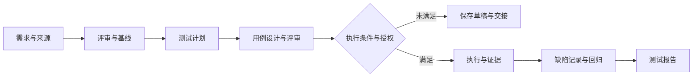

<div align="center">

# QA Master Skill

**把需求变成可追踪的测试工作：从评审、计划和用例，到授权执行、缺陷回归与报告。**

[](pyproject.toml)
[](https://github.com/leongibhub/QA-Master-Skill/actions/workflows/test.yml)
[](LICENSE)

[快速开始](#快速开始) · [使用示例](#按你需要的范围工作) · [完整技能目录](#完整技能目录) · [操作指南](docs/GETTING_STARTED.md) · [验证记录](docs/verification/)

</div>

## 你可以用它完成什么

给 QA Master 一份需求、代码仓库或接口说明，再说明你需要的交付物。它通过 Agent 阅读来源、选择专业指南、形成测试产物；本地工具负责状态保存、规则路由、确定性设计与证据校验。开发尚未完成时，可以先完成评审和设计，保存交接信息后继续。

| 你的任务 | 交付物 | 适用例子 |
| --- | --- | --- |
| 看懂需求、识别风险 | 冲突清单、待确认问题、可测试条件 | 多份需求不一致、验收标准不明确 |
| 制定测试计划 | 范围、优先级、环境与数据需求、退出条件 | 新版本测试、接口改造、系统集成 |
| 编写和评审用例 | 前置条件、步骤、预期结果、来源追踪、覆盖缺口 | 功能、API、状态机、权限、异常路径 |
| 选择专项测试方法 | 相关指南、测试策略与可审查草稿 | Web UI、性能、安全、AI/RAG、混沌测试 |
| 执行、跟踪与回归 | 获授权的执行记录、缺陷材料、回归范围、证据报告 | 已有可测版本、明确环境和执行权限 |
| 跨会话继续工作 | 当前阶段、未决问题、暂停原因与下一步 | 等待构建、等待需求澄清、分阶段交付 |

**单独做一个阶段、组合多个阶段或规划完整流程，都使用同一个入口。** 企业系统接入可选；需求评审和本地设计无需 Jira、GitLab 或测试机。

## 快速开始

需要 Git、支持加载 Skill 的 Agent，以及 Python 3.10+ **或** [uv](https://docs.astral.sh/uv/)。Windows 上不需要手工创建或激活 `.venv`。先克隆仓库；**仅克隆不会安装 `qa-master` 命令**。

### Windows

```cmd
git clone https://github.com/leongibhub/QA-Master-Skill.git
cd QA-Master-Skill
```

然后按机器情况选一条。先运行 `py -3 --version`：版本为 3.10 或更高时，直接从仓库运行即可，不依赖 `qa-master` 是否在 PATH 中：

```cmd
py -3 -m qa_master --help
```

若电脑已经装了 Python 3.10+，但没有 `py` 启动器，可将后续命令中的 `py -3` 换成 `python`。

若没有 Python 3.10+，先安装 uv。可用 Windows 的官方 `winget` 包：

```cmd
winget install --id=astral-sh.uv -e
```

也可按 [uv Windows 安装说明](https://docs.astral.sh/uv/getting-started/installation/) 使用官方安装脚本。安装 uv 后新开一个终端，再运行：

```cmd
uv tool install --force --python 3.13 .
```

`uv` 会下载并管理所需的 Python 3.13。已有 Python 且希望以后也能直接输入 `qa-master` 的用户，可选运行 `py -3 -m pip install --user .`；若 PATH 没有刷新，继续使用稳定的 `py -3 -m qa_master ...` 即可。没有 `py` 启动器但 `python --version` 为 3.10+ 时，使用等价的 `python -m qa_master ...`。

如果 uv 安装完成后仍提示找不到 `qa-master`，运行 `uv tool update-shell`，关闭并重新打开终端后再试；需要立即运行时，可用不依赖 PATH 的前缀 `uv tool run --from . --python 3.13 qa-master`。

选择宿主和范围。下表是已有 Python 用户可直接复制的 Windows `cmd` 命令；PowerShell 中将 `%USERPROFILE%` 改为 `$env:USERPROFILE`。若使用 uv 安装，把每条命令中的 `py -3 -m qa_master` 替换为 `qa-master`；PATH 尚未刷新时替换为上面的 `uv tool run ... qa-master` 前缀。

| 聊天宿主 | 用户级安装 | 项目级安装 | Skill 位置 |
| --- | --- | --- | --- |
| Codex 或 OpenCode | `py -3 -m qa_master install-codex --user` | `py -3 -m qa_master install-codex --project "<项目绝对路径>"` | `%USERPROFILE%\.agents\skills\qa-master`；`<项目>\.agents\skills\qa-master` |
| VS Code 中的 Claude Code | `py -3 -m qa_master install-codex --target "%USERPROFILE%\.claude\skills\qa-master"` | `py -3 -m qa_master install-codex --target "<项目绝对路径>\.claude\skills\qa-master"` | `%USERPROFILE%\.claude\skills\qa-master`；`<项目>\.claude\skills\qa-master` |
| TRAE CN | `py -3 -m qa_master install-codex --target "%USERPROFILE%\.trae-cn\skills\qa-master"` | `py -3 -m qa_master install-codex --target "<项目绝对路径>\.trae\skills\qa-master"` | `%USERPROFILE%\.trae-cn\skills\qa-master`；`<项目>\.trae\skills\qa-master` |

项目路径必须替换为真实绝对路径。`--user`、`--project` 和 `--target` 不能混用。完整的复制命令、更新与排错见 [操作指南](docs/GETTING_STARTED.md)。

Codex/OpenCode 的项目级入口文件为 `<项目>/.agents/skills/qa-master/SKILL.md`。

Claude Code 或 TRAE CN 是加载 Skill 的宿主；DeepSeek 等模型仍由宿主的现有配置使用。QA Master 不读取、不配置模型端点、密码或 API Token。已验证的是安装包写入目标目录；实际某个版本的 Claude Code 或 TRAE CN 是否发现并调用 Skill 仍为 `NOT_EXECUTED`。

安装后，只检查刚才选择的宿主目录；不要把 TRAE CN 的安装结果检查到 Codex/OpenCode 的 `.agents` 目录。执行所选宿主这一行的两个命令：`dir` 应列出 `SKILL.md`，随后本地助手从该同一目录读取资料。

| 安装到的宿主 | 用户级 `SKILL.md` 检查命令 | 同一目录的本地助手自检 |
| --- | --- | --- |
| Codex / OpenCode | `dir "%USERPROFILE%\.agents\skills\qa-master\SKILL.md"` | `py -3 -I "%USERPROFILE%\.agents\skills\qa-master\scripts\qa.py" skills` |
| VS Code Claude Code | `dir "%USERPROFILE%\.claude\skills\qa-master\SKILL.md"` | `py -3 -I "%USERPROFILE%\.claude\skills\qa-master\scripts\qa.py" skills` |
| TRAE CN | `dir "%USERPROFILE%\.trae-cn\skills\qa-master\SKILL.md"` | `py -3 -I "%USERPROFILE%\.trae-cn\skills\qa-master\scripts\qa.py" skills` |

项目级安装时，将表格中的用户级目录替换成上面的对应项目级目录。JSON 中应包含 `vendor.count = 330`，`en = 165` 和 `zh = 165`。没有系统 Python、只安装了 uv 的机器，可把表格中的 `py -3` 替换为 `uv run --no-project --python 3.13 python`。

安装命令输出的 `"status": "INSTALLED"` 表示文件已写入目标目录。`"execution": "NOT_EXECUTED"` 只表示安装过程没有执行任何 QA 工作，并不是安装失败；它也不表示聊天宿主已经发现或调用了 Skill。关闭并新建目标聊天会话，使宿主重新发现 Skill。在 Claude Code 等支持 `/` 命令的宿主中，可先使用这一条最小任务：

```text
/qa-master 阅读当前项目需求并生成测试用例；只做设计，不执行测试，不写入外部系统。
```

TRAE CN 中使用自然语言，例如：`使用 qa-master skill 阅读当前项目需求并生成测试用例；只做设计，不执行测试，不写入外部系统。`

安装包包含指南、双语技能资料和本地助手。`uv` 显示 hardlink 失败并回退为复制时，安装仍可用；若想消除该提示，更新时增加 `--link-mode=copy`。更新与安装自检见 [操作指南](docs/GETTING_STARTED.md)。目录已写入只证明交付完成，不代表某个聊天宿主已经实际加载或端到端执行了 Skill。

### Linux / macOS

已有 Python 3.10+ 时在仓库根目录运行 `python3 -m qa_master install-codex --user`；没有合适 Python 时，按 [uv 安装说明](https://docs.astral.sh/uv/getting-started/installation/) 安装 uv，再运行 `uv tool install --force --python 3.13 .` 和 `qa-master install-codex --user`。Claude Code 目标为 `$HOME/.claude/skills/qa-master`，项目目标为 `<项目>/.claude/skills/qa-master`。完整命令和项目级安装见 [操作指南](docs/GETTING_STARTED.md)。

## 按你需要的范围工作

以下是发给 Agent 的任务示例；把文件名替换成项目中的真实来源。

### 只做一个阶段

```text
$qa-master 只评审 docs/requirements.md，列出矛盾、边界和无法验收的条款。
不要生成用例，也不要执行测试。
```

```text
$qa-master 只评审 tests/cases.md 的测试用例。
不要提交缺陷，只指出来源缺失、预期不明确和重复覆盖的问题。
```

### 组合工作

```text
$qa-master 根据 docs/requirements.md 和 openapi.yaml，完成需求评审、
测试计划、API 用例设计和用例评审。每条用例标明来源；
403/404 等冲突保留为待确认项，不替产品决定。不执行测试。
```

### 规划完整流程

```text
$qa-master 为这个版本规划全流程：需求分析与评审 → 基线确认 → 测试计划
→ 编写用例 → 用例评审 → 获授权后执行 → 缺陷记录 → 回归 → 测试报告。
先读取当前材料并完成设计；执行环境、权限和外部写入范围确认后再推进。
```



执行阶段的选择不会自动授予权限；外部缺陷提交也需要明确的写入范围。没有执行证据时，报告保留 `NOT_EXECUTED` 等真实状态。

### 指定专项能力

```text
$qa-master 使用 rag-quality-testing，为检索增强问答设计质量评估方案。
先列出所需的数据集和判断依据，不运行评测。
```

```text
$qa-master 使用 ui-test-playwright，评审登录页面的浏览器自动化测试设计。
```

可以使用技能的 canonical name 或已支持的中英文别名。模糊请求可能需要澄清，例如“RAG 测试”可能涉及检索或答案质量；规则路由不能理解所有任意表述。完整名称、用途和双语文件入口见下方 [完整技能目录](#完整技能目录)；稳定路径索引见 [技能目录文件](docs/SKILL_CATALOG.md)。

## 三层能力，各有用途

| 层次 | 内容 | 如何使用 |
| --- | --- | --- |
| 工作流与专业指南 | 阶段路由、暂停恢复、6 份专业指南、13 个测试维度 | Agent 阅读来源并组织交付；本地助手保存与检查状态 |
| 确定性设计引擎 | `boundary`、`decision_table`、`state_transition`、`pairwise`、`combinatorial` | 将结构化模型转换为可复核的候选用例和覆盖义务 |
| 专项技能资料 | **165 个逻辑技能，中文和英文各一份，共 330 个目录** | 选择工作流、测试类型或技能工程指南，由 Agent 应用到当前任务 |

165 项按用途分为 10 项工作流、150 项测试类型、5 项技能工程。中英文版本不重复计为独立能力；资料数量也不代表自动执行能力或质量评分。等价类、场景法、属性测试等指南能力与上述 5 种确定性算法分开标注。

## 本地工具：可观察、可复核

在仓库根目录、已激活的虚拟环境中运行；未激活时用虚拟环境 Python 的完整路径替换 `python`。

```bash
python -m qa_master init demo-login
python -m qa_master plan "需求评审 + 测试计划 + 编写用例，不执行测试"
python -m qa_master skills
python -m qa_master design --input examples/design-methods.json --output .qa-master/methods.json
python -m qa_master status
```

- `plan` 返回阶段、信息缺口和所选指南，不会替你阅读需求并生成完整方案。
- `skills` 可检查本地实际发现的指南及双语资料数量。
- `design` 使用仓库中的教学模型；产物标记为 `DRAFT_UNAPPROVED`、`NOT_EXECUTED`，不是业务测试通过证明。
- `pause` / `resume` 保存和恢复流程状态；恢复不会新增执行权限。

普通需求文档可以直接交给 Agent 分析，无需先手工编写 JSON。只有使用确定性引擎时才需要符合契约的结构化输入。更多示例见 [设计方法](qa_master/skills/codex/references/design-methods.md) 和 [Campaign CLI](docs/CAMPAIGN_CLI.md)。

## 完整技能目录

QA Master 当前随包交付 **165 个逻辑技能**：10 个跨阶段工作流、150 个测试类型和 5 个 Skill Engineering 指南；每项有中英文资料，共 330 个资料目录。下表按能力层组织，方便按研发阶段选择。名称链接到当前仓库随包交付的资料；存在或被路由选中不等同于测试已执行。

可以在任务中点名 canonical name，例如 `$qa-master 使用 rag-quality-testing 设计 RAG 评测方案，不运行评测。` 语言资料并不算两项独立能力。

### 跨阶段工作流

工作流负责串联研发测试阶段，不属于四个能力层中的第五层。

#### 需求发现与分析

| 名称 | 目录 | 主要用途 |
| --- | --- | --- |
| 测试技能路由 | [`discover-testing`](qa_master/skills/vendor/awesome-qa-skills/zh/testing-workflows/discover-testing/SKILL.md) · [English](qa_master/skills/vendor/awesome-qa-skills/en/testing-workflows/discover-testing/SKILL.md) | 在执行前根据需求、阶段和风险选择合适的测试 Skill。 |
| 产品质量视角 | [`product-quality-perspective`](qa_master/skills/vendor/awesome-qa-skills/zh/testing-workflows/product-quality-perspective/SKILL.md) · [English](qa_master/skills/vendor/awesome-qa-skills/en/testing-workflows/product-quality-perspective/SKILL.md) | 从产品视角在需求、策略、评审、用例和报告阶段识别用户价值、业务规则、验收与风险。 |
| QA 质量视角 | [`qa-quality-perspective`](qa_master/skills/vendor/awesome-qa-skills/zh/testing-workflows/qa-quality-perspective/SKILL.md) · [English](qa_master/skills/vendor/awesome-qa-skills/en/testing-workflows/qa-quality-perspective/SKILL.md) | 在质量各阶段基于证据评估可测试性、风险驱动覆盖、缺陷风险与质量结论边界。 |
| UX 质量视角 | [`ux-quality-perspective`](qa_master/skills/vendor/awesome-qa-skills/zh/testing-workflows/ux-quality-perspective/SKILL.md) · [English](qa_master/skills/vendor/awesome-qa-skills/en/testing-workflows/ux-quality-perspective/SKILL.md) | 以 UX 视角在质量阶段识别信息架构、交互状态、一致性、响应式与无障碍风险。 |
| 技术质量视角 | [`technical-quality-perspective`](qa_master/skills/vendor/awesome-qa-skills/zh/testing-workflows/technical-quality-perspective/SKILL.md) · [English](qa_master/skills/vendor/awesome-qa-skills/en/testing-workflows/technical-quality-perspective/SKILL.md) | 在指定交付阶段基于证据输出技术质量发现。 |

#### 开发与迭代

| 名称 | 目录 | 主要用途 |
| --- | --- | --- |
| 日常测试工作流程 | [`daily-testing-workflow`](qa_master/skills/vendor/awesome-qa-skills/zh/testing-workflows/daily-testing-workflow/SKILL.md) · [English](qa_master/skills/vendor/awesome-qa-skills/en/testing-workflows/daily-testing-workflow/SKILL.md) | 按日常节奏完成计划、执行、缺陷跟踪和日终收口。 |
| 迭代测试工作流程 | [`sprint-testing-workflow`](qa_master/skills/vendor/awesome-qa-skills/zh/testing-workflows/sprint-testing-workflow/SKILL.md) · [English](qa_master/skills/vendor/awesome-qa-skills/en/testing-workflows/sprint-testing-workflow/SKILL.md) | 覆盖迭代计划、测试执行、评审和复盘的质量工作流。 |
| 项目交付视角 | [`project-delivery-perspective`](qa_master/skills/vendor/awesome-qa-skills/zh/testing-workflows/project-delivery-perspective/SKILL.md) · [English](qa_master/skills/vendor/awesome-qa-skills/en/testing-workflows/project-delivery-perspective/SKILL.md) | 在支持的策略与报告评审阶段记录带来源的交付约束和行动，不改变质量事实。 |

#### 发布与综合

| 名称 | 目录 | 主要用途 |
| --- | --- | --- |
| 发布测试工作流程 | [`release-testing-workflow`](qa_master/skills/vendor/awesome-qa-skills/zh/testing-workflows/release-testing-workflow/SKILL.md) · [English](qa_master/skills/vendor/awesome-qa-skills/en/testing-workflows/release-testing-workflow/SKILL.md) | 从发布前计划到 Go/No-Go 决策和发布后监控的质量工作流。 |
| 多角色质量汇总 | [`multi-role-quality-synthesis`](qa_master/skills/vendor/awesome-qa-skills/zh/testing-workflows/multi-role-quality-synthesis/SKILL.md) · [English](qa_master/skills/vendor/awesome-qa-skills/en/testing-workflows/multi-role-quality-synthesis/SKILL.md) | 将同一阶段的多角色报告合并为保留来源、分歧和质量边界的可追溯汇总 |

### 四层能力体系与研发测试阶段

每个测试类型 Skill 只列一次；跨阶段协作由路由器和工作流补充。

#### Core QA Skills — 基础质量能力

##### 需求发现与分析

| 名称 | 目录 | 主要用途 |
| --- | --- | --- |
| 需求分析 <!-- data-skill:requirements-analysis --> | [`requirements-analysis`](qa_master/skills/vendor/awesome-qa-skills/zh/testing-types/requirements-analysis/SKILL.md) · [English](qa_master/skills/vendor/awesome-qa-skills/en/testing-types/requirements-analysis/SKILL.md) | 在测试设计前识别需求测试点、边界、依赖和风险。 |
| 需求分析加强版 <!-- data-skill:requirements-analysis-plus --> | [`requirements-analysis-plus`](qa_master/skills/vendor/awesome-qa-skills/zh/testing-types/requirements-analysis-plus/SKILL.md) · [English](qa_master/skills/vendor/awesome-qa-skills/en/testing-types/requirements-analysis-plus/SKILL.md) | 解析多种需求文档并输出结构化的需求分析。 |

##### 方案设计与测试策略

| 名称 | 目录 | 主要用途 |
| --- | --- | --- |
| 测试策略 <!-- data-skill:test-strategy --> | [`test-strategy`](qa_master/skills/vendor/awesome-qa-skills/zh/testing-types/test-strategy/SKILL.md) · [English](qa_master/skills/vendor/awesome-qa-skills/en/testing-types/test-strategy/SKILL.md) | 定义测试范围、方法、资源、风险和质量门禁。 |
| 一页纸测试策略 <!-- data-skill:one-page-test-strategy --> | [`one-page-test-strategy`](qa_master/skills/vendor/awesome-qa-skills/zh/testing-types/one-page-test-strategy/SKILL.md) · [English](qa_master/skills/vendor/awesome-qa-skills/en/testing-types/one-page-test-strategy/SKILL.md) | 一页呈现七阶段生命周期、功能/性能/安全、测试象限、精益分层与迭代反馈。 |
| 测试策略加强版 <!-- data-skill:test-strategy-plus --> | [`test-strategy-plus`](qa_master/skills/vendor/awesome-qa-skills/zh/testing-types/test-strategy-plus/SKILL.md) · [English](qa_master/skills/vendor/awesome-qa-skills/en/testing-types/test-strategy-plus/SKILL.md) | 基于需求、分析、技术和计划文档形成结构化测试策略。 |
| 测试策略评审 <!-- data-skill:test-strategy-review --> | [`test-strategy-review`](qa_master/skills/vendor/awesome-qa-skills/zh/testing-types/test-strategy-review/SKILL.md) · [English](qa_master/skills/vendor/awesome-qa-skills/en/testing-types/test-strategy-review/SKILL.md) | 基于证据评审测试策略，区分阻塞项与条件项并给出 Human 待决的 AI 建议 |

##### 测试设计与准备

| 名称 | 目录 | 主要用途 |
| --- | --- | --- |
| 测试用例编写 <!-- data-skill:test-case-writing --> | [`test-case-writing`](qa_master/skills/vendor/awesome-qa-skills/zh/testing-types/test-case-writing/SKILL.md) · [English](qa_master/skills/vendor/awesome-qa-skills/en/testing-types/test-case-writing/SKILL.md) | 编写覆盖正常、异常和边界场景的高质量测试用例。 |
| 测试用例编写加强版 <!-- data-skill:testcase-writer-plus --> | [`testcase-writer-plus`](qa_master/skills/vendor/awesome-qa-skills/zh/testing-types/testcase-writer-plus/SKILL.md) · [English](qa_master/skills/vendor/awesome-qa-skills/en/testing-types/testcase-writer-plus/SKILL.md) | 根据需求与分析产物生成高质量测试用例。 |
| 测试用例评审 <!-- data-skill:test-case-reviewer --> | [`test-case-reviewer`](qa_master/skills/vendor/awesome-qa-skills/zh/testing-types/test-case-reviewer/SKILL.md) · [English](qa_master/skills/vendor/awesome-qa-skills/en/testing-types/test-case-reviewer/SKILL.md) | 评审测试用例的完整性、清晰度、可维护性和遗漏场景。 |
| 测试用例评审加强版 <!-- data-skill:test-case-reviewer-plus --> | [`test-case-reviewer-plus`](qa_master/skills/vendor/awesome-qa-skills/zh/testing-types/test-case-reviewer-plus/SKILL.md) · [English](qa_master/skills/vendor/awesome-qa-skills/en/testing-types/test-case-reviewer-plus/SKILL.md) | 从需求、策略和用例文档中形成结构化评审发现。 |
| 决策表测试 <!-- data-skill:decision-table-testing --> | [`decision-table-testing`](qa_master/skills/vendor/awesome-qa-skills/zh/testing-types/decision-table-testing/SKILL.md) · [English](qa_master/skills/vendor/awesome-qa-skills/en/testing-types/decision-table-testing/SKILL.md) | 将条件、规则、动作和结果整理为可审计的规则组合。 |
| 状态迁移测试 <!-- data-skill:state-transition-testing --> | [`state-transition-testing`](qa_master/skills/vendor/awesome-qa-skills/zh/testing-types/state-transition-testing/SKILL.md) · [English](qa_master/skills/vendor/awesome-qa-skills/en/testing-types/state-transition-testing/SKILL.md) | 从状态、事件、迁移和非法路径设计可追溯测试。 |
| 边界值测试 <!-- data-skill:boundary-value-testing --> | [`boundary-value-testing`](qa_master/skills/vendor/awesome-qa-skills/zh/testing-types/boundary-value-testing/SKILL.md) · [English](qa_master/skills/vendor/awesome-qa-skills/en/testing-types/boundary-value-testing/SKILL.md) | 基于边界模型选择最小且高风险的边界测试集。 |
| 等价类划分 <!-- data-skill:equivalence-partitioning --> | [`equivalence-partitioning`](qa_master/skills/vendor/awesome-qa-skills/zh/testing-types/equivalence-partitioning/SKILL.md) · [English](qa_master/skills/vendor/awesome-qa-skills/en/testing-types/equivalence-partitioning/SKILL.md) | 将输入空间划分为可解释、可覆盖的等价类。 |
| 成对组合测试 <!-- data-skill:pairwise-testing --> | [`pairwise-testing`](qa_master/skills/vendor/awesome-qa-skills/zh/testing-types/pairwise-testing/SKILL.md) · [English](qa_master/skills/vendor/awesome-qa-skills/en/testing-types/pairwise-testing/SKILL.md) | 用成对交互覆盖控制多参数组合爆炸。 |
| 组合测试 <!-- data-skill:combinatorial-testing --> | [`combinatorial-testing`](qa_master/skills/vendor/awesome-qa-skills/zh/testing-types/combinatorial-testing/SKILL.md) · [English](qa_master/skills/vendor/awesome-qa-skills/en/testing-types/combinatorial-testing/SKILL.md) | 根据交互强度和风险选择组合覆盖策略。 |
| 基于模型测试 <!-- data-skill:model-based-testing --> | [`model-based-testing`](qa_master/skills/vendor/awesome-qa-skills/zh/testing-types/model-based-testing/SKILL.md) · [English](qa_master/skills/vendor/awesome-qa-skills/en/testing-types/model-based-testing/SKILL.md) | 从状态、流程或行为模型派生可追溯测试。 |
| 基于属性测试 <!-- data-skill:property-based-testing --> | [`property-based-testing`](qa_master/skills/vendor/awesome-qa-skills/zh/testing-types/property-based-testing/SKILL.md) · [English](qa_master/skills/vendor/awesome-qa-skills/en/testing-types/property-based-testing/SKILL.md) | 用不变量、生成策略和收缩规则验证属性。 |
| 变形测试 <!-- data-skill:metamorphic-testing --> | [`metamorphic-testing`](qa_master/skills/vendor/awesome-qa-skills/zh/testing-types/metamorphic-testing/SKILL.md) · [English](qa_master/skills/vendor/awesome-qa-skills/en/testing-types/metamorphic-testing/SKILL.md) | 在缺少可靠预言机时用输入变换和关系断言验证结果。 |

##### 测试执行与分析

| 名称 | 目录 | 主要用途 |
| --- | --- | --- |
| 功能测试 <!-- data-skill:functional-testing --> | [`functional-testing`](qa_master/skills/vendor/awesome-qa-skills/zh/testing-types/functional-testing/SKILL.md) · [English](qa_master/skills/vendor/awesome-qa-skills/en/testing-types/functional-testing/SKILL.md) | 为业务流程、界面、数据和集成设计功能测试方案或用例。 |
| API 测试 <!-- data-skill:api-testing --> | [`api-testing`](qa_master/skills/vendor/awesome-qa-skills/zh/testing-types/api-testing/SKILL.md) · [English](qa_master/skills/vendor/awesome-qa-skills/en/testing-types/api-testing/SKILL.md) | 为 REST、GraphQL 或 gRPC 接口设计 API 测试方案或用例。 |
| 手动/探索性测试 <!-- data-skill:manual-testing --> | [`manual-testing`](qa_master/skills/vendor/awesome-qa-skills/zh/testing-types/manual-testing/SKILL.md) · [English](qa_master/skills/vendor/awesome-qa-skills/en/testing-types/manual-testing/SKILL.md) | 使用章程、启发式方法和会话记录规划手动或探索性测试。 |
| 移动端测试 <!-- data-skill:mobile-testing --> | [`mobile-testing`](qa_master/skills/vendor/awesome-qa-skills/zh/testing-types/mobile-testing/SKILL.md) · [English](qa_master/skills/vendor/awesome-qa-skills/en/testing-types/mobile-testing/SKILL.md) | 覆盖功能、兼容性、性能、网络和安全的 iOS/Android 测试。 |
| 可访问性测试 <!-- data-skill:accessibility-testing --> | [`accessibility-testing`](qa_master/skills/vendor/awesome-qa-skills/zh/testing-types/accessibility-testing/SKILL.md) · [English](qa_master/skills/vendor/awesome-qa-skills/en/testing-types/accessibility-testing/SKILL.md) | 按 WCAG、键盘导航和辅助技术场景设计可访问性测试。 |
| 安全测试 <!-- data-skill:security-testing --> | [`security-testing`](qa_master/skills/vendor/awesome-qa-skills/zh/testing-types/security-testing/SKILL.md) · [English](qa_master/skills/vendor/awesome-qa-skills/en/testing-types/security-testing/SKILL.md) | 围绕 OWASP 风险、漏洞扫描和渗透场景设计安全测试。 |

##### 发布、缺陷与报告

| 名称 | 目录 | 主要用途 |
| --- | --- | --- |
| 缺陷上报 <!-- data-skill:bug-reporting --> | [`bug-reporting`](qa_master/skills/vendor/awesome-qa-skills/zh/testing-types/bug-reporting/SKILL.md) · [English](qa_master/skills/vendor/awesome-qa-skills/en/testing-types/bug-reporting/SKILL.md) | 编写包含复现步骤、环境信息和证据的清晰缺陷报告。 |
| 测试报告 <!-- data-skill:test-reporting --> | [`test-reporting`](qa_master/skills/vendor/awesome-qa-skills/zh/testing-types/test-reporting/SKILL.md) · [English](qa_master/skills/vendor/awesome-qa-skills/en/testing-types/test-reporting/SKILL.md) | 生成包含摘要、指标、缺陷分析和风险评估的测试报告。 |
| 测试报告评审 <!-- data-skill:test-report-review --> | [`test-report-review`](qa_master/skills/vendor/awesome-qa-skills/zh/testing-types/test-report-review/SKILL.md) · [English](qa_master/skills/vendor/awesome-qa-skills/en/testing-types/test-report-review/SKILL.md) | 核对测试报告与执行、缺陷和范围证据，形成 Human 待决的 AI 建议 |

#### Engineering QA Skills — 质量工程能力

##### 需求与质量左移

| 名称 | 目录 | 主要用途 |
| --- | --- | --- |
| 验收标准评审 <!-- data-skill:acceptance-criteria-review --> | [`acceptance-criteria-review`](qa_master/skills/vendor/awesome-qa-skills/zh/testing-types/acceptance-criteria-review/SKILL.md) · [English](qa_master/skills/vendor/awesome-qa-skills/en/testing-types/acceptance-criteria-review/SKILL.md) | 评审验收标准的可验证性与缺口 |
| 需求缺口分析 <!-- data-skill:requirement-gap-analysis --> | [`requirement-gap-analysis`](qa_master/skills/vendor/awesome-qa-skills/zh/testing-types/requirement-gap-analysis/SKILL.md) · [English](qa_master/skills/vendor/awesome-qa-skills/en/testing-types/requirement-gap-analysis/SKILL.md) | 识别需求信息缺口、冲突与影响 |
| 质量风险分析 <!-- data-skill:quality-risk-analysis --> | [`quality-risk-analysis`](qa_master/skills/vendor/awesome-qa-skills/zh/testing-types/quality-risk-analysis/SKILL.md) · [English](qa_master/skills/vendor/awesome-qa-skills/en/testing-types/quality-risk-analysis/SKILL.md) | 基于证据识别并排序质量风险 |
| 可测试性分析 <!-- data-skill:testability-analysis --> | [`testability-analysis`](qa_master/skills/vendor/awesome-qa-skills/zh/testing-types/testability-analysis/SKILL.md) · [English](qa_master/skills/vendor/awesome-qa-skills/en/testing-types/testability-analysis/SKILL.md) | 评估需求或设计的可测试性与阻碍 |
| 需求质量评审 <!-- data-skill:requirement-quality-review --> | [`requirement-quality-review`](qa_master/skills/vendor/awesome-qa-skills/zh/testing-types/requirement-quality-review/SKILL.md) · [English](qa_master/skills/vendor/awesome-qa-skills/en/testing-types/requirement-quality-review/SKILL.md) | 在测试设计前，从完整性、清晰度、可验证性、可行性、范围和证据质量评审需求 |
| 需求歧义分析 <!-- data-skill:requirement-ambiguity-analysis --> | [`requirement-ambiguity-analysis`](qa_master/skills/vendor/awesome-qa-skills/zh/testing-types/requirement-ambiguity-analysis/SKILL.md) · [English](qa_master/skills/vendor/awesome-qa-skills/en/testing-types/requirement-ambiguity-analysis/SKILL.md) | 识别角色、对象、条件、数量、时间、状态和验收语句中的歧义 |
| 需求一致性分析 <!-- data-skill:requirement-consistency-analysis --> | [`requirement-consistency-analysis`](qa_master/skills/vendor/awesome-qa-skills/zh/testing-types/requirement-consistency-analysis/SKILL.md) · [English](qa_master/skills/vendor/awesome-qa-skills/en/testing-types/requirement-consistency-analysis/SKILL.md) | 比较跨来源术语、标识、格式、状态、规则和行为的一致性 |
| 需求冲突检测 <!-- data-skill:requirement-conflict-detection --> | [`requirement-conflict-detection`](qa_master/skills/vendor/awesome-qa-skills/zh/testing-types/requirement-conflict-detection/SKILL.md) · [English](qa_master/skills/vendor/awesome-qa-skills/en/testing-types/requirement-conflict-detection/SKILL.md) | 识别同一适用范围内互斥的需求规则并保留 Human 决策边界 |
| 需求可追踪性分析 <!-- data-skill:requirement-traceability-analysis --> | [`requirement-traceability-analysis`](qa_master/skills/vendor/awesome-qa-skills/zh/testing-types/requirement-traceability-analysis/SKILL.md) · [English](qa_master/skills/vendor/awesome-qa-skills/en/testing-types/requirement-traceability-analysis/SKILL.md) | 建立需求与验收、设计、代码、测试、缺陷和证据的双向追踪 |
| 业务规则提取 <!-- data-skill:business-rule-extraction --> | [`business-rule-extraction`](qa_master/skills/vendor/awesome-qa-skills/zh/testing-types/business-rule-extraction/SKILL.md) · [English](qa_master/skills/vendor/awesome-qa-skills/en/testing-types/business-rule-extraction/SKILL.md) | 从需求、政策和流程材料中提取有来源、有范围、有例外的业务规则 |
| 技术设计质量评审 <!-- data-skill:technical-design-quality-review --> | [`technical-design-quality-review`](qa_master/skills/vendor/awesome-qa-skills/zh/testing-types/technical-design-quality-review/SKILL.md) · [English](qa_master/skills/vendor/awesome-qa-skills/en/testing-types/technical-design-quality-review/SKILL.md) | 从边界、失败、数据、安全、性能和可运维性评审技术设计 |
| API 设计质量评审 <!-- data-skill:api-design-quality-review --> | [`api-design-quality-review`](qa_master/skills/vendor/awesome-qa-skills/zh/testing-types/api-design-quality-review/SKILL.md) · [English](qa_master/skills/vendor/awesome-qa-skills/en/testing-types/api-design-quality-review/SKILL.md) | 评审 API 契约、错误、认证、幂等、分页、版本和消费者影响 |
| 数据库设计质量评审 <!-- data-skill:database-design-quality-review --> | [`database-design-quality-review`](qa_master/skills/vendor/awesome-qa-skills/zh/testing-types/database-design-quality-review/SKILL.md) · [English](qa_master/skills/vendor/awesome-qa-skills/en/testing-types/database-design-quality-review/SKILL.md) | 评审模型、约束、索引、生命周期、并发、迁移和恢复设计 |
| 可观测性设计评审 <!-- data-skill:observability-design-review --> | [`observability-design-review`](qa_master/skills/vendor/awesome-qa-skills/zh/testing-types/observability-design-review/SKILL.md) · [English](qa_master/skills/vendor/awesome-qa-skills/en/testing-types/observability-design-review/SKILL.md) | 评审信号、维度、语义、告警、隐私、基数、采样和保留策略 |
| 错误处理设计评审 <!-- data-skill:error-handling-design-review --> | [`error-handling-design-review`](qa_master/skills/vendor/awesome-qa-skills/zh/testing-types/error-handling-design-review/SKILL.md) · [English](qa_master/skills/vendor/awesome-qa-skills/en/testing-types/error-handling-design-review/SKILL.md) | 评审失败模式、重试、降级、传播、一致性和遥测设计 |
| 测试范围分析 <!-- data-skill:test-scope-analysis --> | [`test-scope-analysis`](qa_master/skills/vendor/awesome-qa-skills/zh/testing-types/test-scope-analysis/SKILL.md) · [English](qa_master/skills/vendor/awesome-qa-skills/en/testing-types/test-scope-analysis/SKILL.md) | 基于目标、风险、依赖和证据明确测试纳入、排除与深度 |
| 测试缺口分析 <!-- data-skill:test-gap-analysis --> | [`test-gap-analysis`](qa_master/skills/vendor/awesome-qa-skills/zh/testing-types/test-gap-analysis/SKILL.md) · [English](qa_master/skills/vendor/awesome-qa-skills/en/testing-types/test-gap-analysis/SKILL.md) | 从需求、风险、变更、缺陷和测试证据中发现未被充分保护的测试义务 |
| 基于风险的测试 <!-- data-skill:risk-based-testing --> | [`risk-based-testing`](qa_master/skills/vendor/awesome-qa-skills/zh/testing-types/risk-based-testing/SKILL.md) · [English](qa_master/skills/vendor/awesome-qa-skills/en/testing-types/risk-based-testing/SKILL.md) | 将风险证据转换为测试优先级、方法、深度和范围取舍 |
| 边界场景发现 <!-- data-skill:edge-case-discovery --> | [`edge-case-discovery`](qa_master/skills/vendor/awesome-qa-skills/zh/testing-types/edge-case-discovery/SKILL.md) · [English](qa_master/skills/vendor/awesome-qa-skills/en/testing-types/edge-case-discovery/SKILL.md) | 从需求、状态、时间、资源和平台证据中发现边界候选 |
| 负向场景发现 <!-- data-skill:negative-scenario-discovery --> | [`negative-scenario-discovery`](qa_master/skills/vendor/awesome-qa-skills/zh/testing-types/negative-scenario-discovery/SKILL.md) · [English](qa_master/skills/vendor/awesome-qa-skills/en/testing-types/negative-scenario-discovery/SKILL.md) | 从产品证据中发现非法、拒绝、失败、降级和恢复候选 |

##### 可靠性与安全

| 名称 | 目录 | 主要用途 |
| --- | --- | --- |
| 可靠性测试 <!-- data-skill:reliability-testing --> | [`reliability-testing`](qa_master/skills/vendor/awesome-qa-skills/zh/testing-types/reliability-testing/SKILL.md) · [English](qa_master/skills/vendor/awesome-qa-skills/en/testing-types/reliability-testing/SKILL.md) | 围绕可靠性目标、故障模式和证据准备形成分析候选。 |
| 韧性测试 <!-- data-skill:resilience-testing --> | [`resilience-testing`](qa_master/skills/vendor/awesome-qa-skills/zh/testing-types/resilience-testing/SKILL.md) · [English](qa_master/skills/vendor/awesome-qa-skills/en/testing-types/resilience-testing/SKILL.md) | 分析降级、韧性和有限恢复证据。 |
| 混沌测试 <!-- data-skill:chaos-testing --> | [`chaos-testing`](qa_master/skills/vendor/awesome-qa-skills/zh/testing-types/chaos-testing/SKILL.md) · [English](qa_master/skills/vendor/awesome-qa-skills/en/testing-types/chaos-testing/SKILL.md) | 设计受控故障注入假设和安全边界。 |
| 故障切换测试 <!-- data-skill:failover-testing --> | [`failover-testing`](qa_master/skills/vendor/awesome-qa-skills/zh/testing-types/failover-testing/SKILL.md) · [English](qa_master/skills/vendor/awesome-qa-skills/en/testing-types/failover-testing/SKILL.md) | 识别主备切换路径、触发条件和恢复证据。 |
| 恢复测试 <!-- data-skill:recovery-testing --> | [`recovery-testing`](qa_master/skills/vendor/awesome-qa-skills/zh/testing-types/recovery-testing/SKILL.md) · [English](qa_master/skills/vendor/awesome-qa-skills/en/testing-types/recovery-testing/SKILL.md) | 定义恢复目标、证据缺口和验证准备。 |
| 重试测试 <!-- data-skill:retry-testing --> | [`retry-testing`](qa_master/skills/vendor/awesome-qa-skills/zh/testing-types/retry-testing/SKILL.md) · [English](qa_master/skills/vendor/awesome-qa-skills/en/testing-types/retry-testing/SKILL.md) | 分析重试安全、幂等、退避和耗尽行为。 |
| 超时测试 <!-- data-skill:timeout-testing --> | [`timeout-testing`](qa_master/skills/vendor/awesome-qa-skills/zh/testing-types/timeout-testing/SKILL.md) · [English](qa_master/skills/vendor/awesome-qa-skills/en/testing-types/timeout-testing/SKILL.md) | 分析超时预算、取消和下游边界。 |
| 熔断器测试 <!-- data-skill:circuit-breaker-testing --> | [`circuit-breaker-testing`](qa_master/skills/vendor/awesome-qa-skills/zh/testing-types/circuit-breaker-testing/SKILL.md) · [English](qa_master/skills/vendor/awesome-qa-skills/en/testing-types/circuit-breaker-testing/SKILL.md) | 分析熔断器状态、降级和恢复证据。 |
| 依赖故障测试 <!-- data-skill:dependency-failure-testing --> | [`dependency-failure-testing`](qa_master/skills/vendor/awesome-qa-skills/zh/testing-types/dependency-failure-testing/SKILL.md) · [English](qa_master/skills/vendor/awesome-qa-skills/en/testing-types/dependency-failure-testing/SKILL.md) | 分类依赖故障并审查隔离与兜底证据。 |
| 灾备测试 <!-- data-skill:disaster-recovery-testing --> | [`disaster-recovery-testing`](qa_master/skills/vendor/awesome-qa-skills/zh/testing-types/disaster-recovery-testing/SKILL.md) · [English](qa_master/skills/vendor/awesome-qa-skills/en/testing-types/disaster-recovery-testing/SKILL.md) | 记录灾备目标、Runbook 和恢复验证准备。 |
| 身份认证测试 <!-- data-skill:authentication-testing --> | [`authentication-testing`](qa_master/skills/vendor/awesome-qa-skills/zh/testing-types/authentication-testing/SKILL.md) · [English](qa_master/skills/vendor/awesome-qa-skills/en/testing-types/authentication-testing/SKILL.md) | 审查身份凭证、生命周期和认证失败证据。 |
| 授权测试 <!-- data-skill:authorization-testing --> | [`authorization-testing`](qa_master/skills/vendor/awesome-qa-skills/zh/testing-types/authorization-testing/SKILL.md) · [English](qa_master/skills/vendor/awesome-qa-skills/en/testing-types/authorization-testing/SKILL.md) | 审查主体、资源、动作和权限边界决策。 |
| 会话安全测试 <!-- data-skill:session-security-testing --> | [`session-security-testing`](qa_master/skills/vendor/awesome-qa-skills/zh/testing-types/session-security-testing/SKILL.md) · [English](qa_master/skills/vendor/awesome-qa-skills/en/testing-types/session-security-testing/SKILL.md) | 审查会话生命周期、固定、过期和撤销风险。 |
| API 安全测试 <!-- data-skill:api-security-testing --> | [`api-security-testing`](qa_master/skills/vendor/awesome-qa-skills/zh/testing-types/api-security-testing/SKILL.md) · [English](qa_master/skills/vendor/awesome-qa-skills/en/testing-types/api-security-testing/SKILL.md) | 审查 API 攻击面和安全契约边界。 |
| 安全需求审查 <!-- data-skill:security-requirement-review --> | [`security-requirement-review`](qa_master/skills/vendor/awesome-qa-skills/zh/testing-types/security-requirement-review/SKILL.md) · [English](qa_master/skills/vendor/awesome-qa-skills/en/testing-types/security-requirement-review/SKILL.md) | 审查安全需求的可追踪性和可测试性。 |
| 威胁建模 <!-- data-skill:threat-modeling --> | [`threat-modeling`](qa_master/skills/vendor/awesome-qa-skills/zh/testing-types/threat-modeling/SKILL.md) · [English](qa_master/skills/vendor/awesome-qa-skills/en/testing-types/threat-modeling/SKILL.md) | 建立资产、信任边界、威胁和缓解模型。 |
| 敏感信息暴露审查 <!-- data-skill:secrets-exposure-review --> | [`secrets-exposure-review`](qa_master/skills/vendor/awesome-qa-skills/zh/testing-types/secrets-exposure-review/SKILL.md) · [English](qa_master/skills/vendor/awesome-qa-skills/en/testing-types/secrets-exposure-review/SKILL.md) | 审查敏感信息位置、生命周期和暴露证据。 |

##### 质量工程与效能

| 名称 | 目录 | 主要用途 |
| --- | --- | --- |
| 质量门禁设计 <!-- data-skill:quality-gate-design --> | [`quality-gate-design`](qa_master/skills/vendor/awesome-qa-skills/zh/testing-types/quality-gate-design/SKILL.md) · [English](qa_master/skills/vendor/awesome-qa-skills/en/testing-types/quality-gate-design/SKILL.md) | 定义有证据的通过、阻塞、升级和例外规则 |
| 质量指标设计 <!-- data-skill:quality-metrics-design --> | [`quality-metrics-design`](qa_master/skills/vendor/awesome-qa-skills/zh/testing-types/quality-metrics-design/SKILL.md) · [English](qa_master/skills/vendor/awesome-qa-skills/en/testing-types/quality-metrics-design/SKILL.md) | 定义指标、分子分母、数据源、时效和解释边界 |
| 质量仪表盘设计 <!-- data-skill:quality-dashboard-design --> | [`quality-dashboard-design`](qa_master/skills/vendor/awesome-qa-skills/zh/testing-types/quality-dashboard-design/SKILL.md) · [English](qa_master/skills/vendor/awesome-qa-skills/en/testing-types/quality-dashboard-design/SKILL.md) | 设计决策问题、面板、钻取、刷新和告警语义 |
| 质量债务分析 <!-- data-skill:quality-debt-analysis --> | [`quality-debt-analysis`](qa_master/skills/vendor/awesome-qa-skills/zh/testing-types/quality-debt-analysis/SKILL.md) · [English](qa_master/skills/vendor/awesome-qa-skills/en/testing-types/quality-debt-analysis/SKILL.md) | 盘点质量债务来源、影响、年龄、所有人和偿还权衡 |
| 质量成熟度评估 <!-- data-skill:quality-maturity-assessment --> | [`quality-maturity-assessment`](qa_master/skills/vendor/awesome-qa-skills/zh/testing-types/quality-maturity-assessment/SKILL.md) · [English](qa_master/skills/vendor/awesome-qa-skills/en/testing-types/quality-maturity-assessment/SKILL.md) | 用证据锚点评估质量实践成熟度和改进缺口 |
| 测试有效性分析 <!-- data-skill:test-effectiveness-analysis --> | [`test-effectiveness-analysis`](qa_master/skills/vendor/awesome-qa-skills/zh/testing-types/test-effectiveness-analysis/SKILL.md) · [English](qa_master/skills/vendor/awesome-qa-skills/en/testing-types/test-effectiveness-analysis/SKILL.md) | 分析测试信号、风险覆盖、漏检限制和验证计划 |
| 自动化投资回报分析 <!-- data-skill:automation-roi-analysis --> | [`automation-roi-analysis`](qa_master/skills/vendor/awesome-qa-skills/zh/testing-types/automation-roi-analysis/SKILL.md) · [English](qa_master/skills/vendor/awesome-qa-skills/en/testing-types/automation-roi-analysis/SKILL.md) | 比较自动化建设、运行、维护成本与收益假设 |
| 测试瓶颈分析 <!-- data-skill:testing-bottleneck-analysis --> | [`testing-bottleneck-analysis`](qa_master/skills/vendor/awesome-qa-skills/zh/testing-types/testing-bottleneck-analysis/SKILL.md) · [English](qa_master/skills/vendor/awesome-qa-skills/en/testing-types/testing-bottleneck-analysis/SKILL.md) | 定位测试等待、依赖、容量、交接和约束证据 |
| 回归优化 <!-- data-skill:regression-optimization --> | [`regression-optimization`](qa_master/skills/vendor/awesome-qa-skills/zh/testing-types/regression-optimization/SKILL.md) · [English](qa_master/skills/vendor/awesome-qa-skills/en/testing-types/regression-optimization/SKILL.md) | 在风险、反馈时间、并行、缓存和维护之间优化回归范围 |
| CI 测试优化 <!-- data-skill:ci-test-optimization --> | [`ci-test-optimization`](qa_master/skills/vendor/awesome-qa-skills/zh/testing-types/ci-test-optimization/SKILL.md) · [English](qa_master/skills/vendor/awesome-qa-skills/en/testing-types/ci-test-optimization/SKILL.md) | 优化 CI 阶段、反馈、波动、资源、缓存和分片 |
| 测试运行时间优化 <!-- data-skill:test-runtime-optimization --> | [`test-runtime-optimization`](qa_master/skills/vendor/awesome-qa-skills/zh/testing-types/test-runtime-optimization/SKILL.md) · [English](qa_master/skills/vendor/awesome-qa-skills/en/testing-types/test-runtime-optimization/SKILL.md) | 基于剖析和基线优化慢测试、初始化、清理、并行和隔离 |
| 测试维护成本分析 <!-- data-skill:test-maintenance-cost-analysis --> | [`test-maintenance-cost-analysis`](qa_master/skills/vendor/awesome-qa-skills/zh/testing-types/test-maintenance-cost-analysis/SKILL.md) · [English](qa_master/skills/vendor/awesome-qa-skills/en/testing-types/test-maintenance-cost-analysis/SKILL.md) | 分析变更频率、修复工时、波动成本、所有权和可维护性 |
| 质量生产力指标 <!-- data-skill:quality-productivity-metrics --> | [`quality-productivity-metrics`](qa_master/skills/vendor/awesome-qa-skills/zh/testing-types/quality-productivity-metrics/SKILL.md) · [English](qa_master/skills/vendor/awesome-qa-skills/en/testing-types/quality-productivity-metrics/SKILL.md) | 定义质量与交付生产力指标并保留归因和操纵边界 |

##### 开发与持续集成

| 名称 | 目录 | 主要用途 |
| --- | --- | --- |
| 代码审查 <!-- data-skill:code-review --> | [`code-review`](qa_master/skills/vendor/awesome-qa-skills/zh/testing-types/code-review/SKILL.md) · [English](qa_master/skills/vendor/awesome-qa-skills/en/testing-types/code-review/SKILL.md) | 对 PR 或 Diff 进行风险驱动的代码审查，输出 P0/P1/P2 问题与可执行修复建议。 |
| 变更影响分析 <!-- data-skill:change-impact-analysis --> | [`change-impact-analysis`](qa_master/skills/vendor/awesome-qa-skills/zh/testing-types/change-impact-analysis/SKILL.md) · [English](qa_master/skills/vendor/awesome-qa-skills/en/testing-types/change-impact-analysis/SKILL.md) | 分析变更的质量影响范围与风险 |
| PR 测试影响分析 <!-- data-skill:pr-test-impact-analysis --> | [`pr-test-impact-analysis`](qa_master/skills/vendor/awesome-qa-skills/zh/testing-types/pr-test-impact-analysis/SKILL.md) · [English](qa_master/skills/vendor/awesome-qa-skills/en/testing-types/pr-test-impact-analysis/SKILL.md) | 从 PR 或 Diff 分析测试影响 |
| API 契约测试 <!-- data-skill:api-contract-testing --> | [`api-contract-testing`](qa_master/skills/vendor/awesome-qa-skills/zh/testing-types/api-contract-testing/SKILL.md) · [English](qa_master/skills/vendor/awesome-qa-skills/en/testing-types/api-contract-testing/SKILL.md) | 验证 API 契约兼容性与变更风险 |
| 自动化测试 <!-- data-skill:automation-testing --> | [`automation-testing`](qa_master/skills/vendor/awesome-qa-skills/zh/testing-types/automation-testing/SKILL.md) · [English](qa_master/skills/vendor/awesome-qa-skills/en/testing-types/automation-testing/SKILL.md) | 使用 POM、数据驱动或 BDD 等模式设计自动化测试方案。 |
| API Schema 校验 <!-- data-skill:api-schema-validation --> | [`api-schema-validation`](qa_master/skills/vendor/awesome-qa-skills/zh/testing-types/api-schema-validation/SKILL.md) · [English](qa_master/skills/vendor/awesome-qa-skills/en/testing-types/api-schema-validation/SKILL.md) | 将 API Schema 与请求、响应和版本证据进行可追溯比对。 |
| API 负向测试 <!-- data-skill:api-negative-testing --> | [`api-negative-testing`](qa_master/skills/vendor/awesome-qa-skills/zh/testing-types/api-negative-testing/SKILL.md) · [English](qa_master/skills/vendor/awesome-qa-skills/en/testing-types/api-negative-testing/SKILL.md) | 从契约和错误证据设计非法输入、拒绝与降级候选。 |
| API 幂等性测试 <!-- data-skill:api-idempotency-testing --> | [`api-idempotency-testing`](qa_master/skills/vendor/awesome-qa-skills/zh/testing-types/api-idempotency-testing/SKILL.md) · [English](qa_master/skills/vendor/awesome-qa-skills/en/testing-types/api-idempotency-testing/SKILL.md) | 围绕重复请求、重试、幂等键和副作用设计验证候选。 |
| API 分页测试 <!-- data-skill:api-pagination-testing --> | [`api-pagination-testing`](qa_master/skills/vendor/awesome-qa-skills/zh/testing-types/api-pagination-testing/SKILL.md) · [English](qa_master/skills/vendor/awesome-qa-skills/en/testing-types/api-pagination-testing/SKILL.md) | 根据分页、排序和数据集证据识别边界、连续性和一致性风险。 |
| API 限流测试 <!-- data-skill:api-rate-limit-testing --> | [`api-rate-limit-testing`](qa_master/skills/vendor/awesome-qa-skills/zh/testing-types/api-rate-limit-testing/SKILL.md) · [English](qa_master/skills/vendor/awesome-qa-skills/en/testing-types/api-rate-limit-testing/SKILL.md) | 根据配额、窗口、突发和恢复证据设计限流候选。 |
| API 版本兼容性测试 <!-- data-skill:api-version-compatibility-testing --> | [`api-version-compatibility-testing`](qa_master/skills/vendor/awesome-qa-skills/zh/testing-types/api-version-compatibility-testing/SKILL.md) · [English](qa_master/skills/vendor/awesome-qa-skills/en/testing-types/api-version-compatibility-testing/SKILL.md) | 从版本契约、旧客户端和弃用证据评估兼容性风险。 |
| API 错误契约测试 <!-- data-skill:api-error-contract-testing --> | [`api-error-contract-testing`](qa_master/skills/vendor/awesome-qa-skills/zh/testing-types/api-error-contract-testing/SKILL.md) · [English](qa_master/skills/vendor/awesome-qa-skills/en/testing-types/api-error-contract-testing/SKILL.md) | 评审错误状态码、错误码、字段结构和脱敏行为的一致性。 |

##### 测试数据与自动化实现

| 名称 | 目录 | 主要用途 |
| --- | --- | --- |
| 测试数据需求分析 <!-- data-skill:test-data-requirement-analysis --> | [`test-data-requirement-analysis`](qa_master/skills/vendor/awesome-qa-skills/zh/testing-types/test-data-requirement-analysis/SKILL.md) · [English](qa_master/skills/vendor/awesome-qa-skills/en/testing-types/test-data-requirement-analysis/SKILL.md) | 在测试设计或数据生成前分析实体、关系、隐私、生命周期、初始化、清理和阻塞项 |
| 测试数据生成 <!-- data-skill:test-data-generation --> | [`test-data-generation`](qa_master/skills/vendor/awesome-qa-skills/zh/testing-types/test-data-generation/SKILL.md) · [English](qa_master/skills/vendor/awesome-qa-skills/en/testing-types/test-data-generation/SKILL.md) | 设计安全且具代表性的测试数据 |
| Bruno 接口自动化 <!-- data-skill:api-test-bruno --> | [`api-test-bruno`](qa_master/skills/vendor/awesome-qa-skills/zh/testing-types/api-test-bruno/SKILL.md) · [English](qa_master/skills/vendor/awesome-qa-skills/en/testing-types/api-test-bruno/SKILL.md) | 解析多格式 API 定义，生成可执行回归的 Bruno 集合。 |
| Postman API 测试 <!-- data-skill:api-test-postman --> | [`api-test-postman`](qa_master/skills/vendor/awesome-qa-skills/zh/testing-types/api-test-postman/SKILL.md) · [English](qa_master/skills/vendor/awesome-qa-skills/en/testing-types/api-test-postman/SKILL.md) | 设计 Postman 集合、环境、脚本和可用 Newman 执行的 API 回归方案。 |
| Pytest 接口自动化 <!-- data-skill:api-test-pytest --> | [`api-test-pytest`](qa_master/skills/vendor/awesome-qa-skills/zh/testing-types/api-test-pytest/SKILL.md) · [English](qa_master/skills/vendor/awesome-qa-skills/en/testing-types/api-test-pytest/SKILL.md) | 解析多格式 API 定义并生成 Pytest 接口自动化方案。 |
| RestAssured 接口自动化 <!-- data-skill:api-test-restassure --> | [`api-test-restassure`](qa_master/skills/vendor/awesome-qa-skills/zh/testing-types/api-test-restassure/SKILL.md) · [English](qa_master/skills/vendor/awesome-qa-skills/en/testing-types/api-test-restassure/SKILL.md) | 解析多格式 API 定义并生成 Rest Assured Java 测试类。 |
| Supertest 接口自动化 <!-- data-skill:api-test-supertest --> | [`api-test-supertest`](qa_master/skills/vendor/awesome-qa-skills/zh/testing-types/api-test-supertest/SKILL.md) · [English](qa_master/skills/vendor/awesome-qa-skills/en/testing-types/api-test-supertest/SKILL.md) | 解析多格式 API 定义并生成可执行的 Supertest 脚本。 |
| Selenium UI 自动化测试 <!-- data-skill:ui-test-selenium --> | [`ui-test-selenium`](qa_master/skills/vendor/awesome-qa-skills/zh/testing-types/ui-test-selenium/SKILL.md) · [English](qa_master/skills/vendor/awesome-qa-skills/en/testing-types/ui-test-selenium/SKILL.md) | 设计 Selenium WebDriver UI 自动化方案，覆盖稳定定位、等待、Page Object、Grid 和 CI 执行。 |
| Playwright UI 自动化测试 <!-- data-skill:ui-test-playwright --> | [`ui-test-playwright`](qa_master/skills/vendor/awesome-qa-skills/zh/testing-types/ui-test-playwright/SKILL.md) · [English](qa_master/skills/vendor/awesome-qa-skills/en/testing-types/ui-test-playwright/SKILL.md) | 设计 Playwright Test 套件，覆盖 fixtures、projects、trace、截图、API+UI 组合和 CI 报告。 |
| TestCafe UI 自动化测试 <!-- data-skill:ui-test-testcafe --> | [`ui-test-testcafe`](qa_master/skills/vendor/awesome-qa-skills/zh/testing-types/ui-test-testcafe/SKILL.md) · [English](qa_master/skills/vendor/awesome-qa-skills/en/testing-types/ui-test-testcafe/SKILL.md) | 设计 TestCafe UI 自动化方案，覆盖 fixture、selector、role、浏览器矩阵和报告。 |
| Cypress UI 自动化测试 <!-- data-skill:ui-test-cypress --> | [`ui-test-cypress`](qa_master/skills/vendor/awesome-qa-skills/zh/testing-types/ui-test-cypress/SKILL.md) · [English](qa_master/skills/vendor/awesome-qa-skills/en/testing-types/ui-test-cypress/SKILL.md) | 设计 Cypress e2e 与组件测试方案，覆盖 commands、fixtures、网络桩和 CI 报告。 |
| Puppeteer UI 自动化测试 <!-- data-skill:ui-test-puppeteer --> | [`ui-test-puppeteer`](qa_master/skills/vendor/awesome-qa-skills/zh/testing-types/ui-test-puppeteer/SKILL.md) · [English](qa_master/skills/vendor/awesome-qa-skills/en/testing-types/ui-test-puppeteer/SKILL.md) | 设计 Puppeteer 自动化方案，覆盖 Chromium 检查、截图、PDF、网络拦截和 CDP 场景。 |
| WebdriverIO UI 自动化测试 <!-- data-skill:ui-test-webdriverio --> | [`ui-test-webdriverio`](qa_master/skills/vendor/awesome-qa-skills/zh/testing-types/ui-test-webdriverio/SKILL.md) · [English](qa_master/skills/vendor/awesome-qa-skills/en/testing-types/ui-test-webdriverio/SKILL.md) | 设计 WebdriverIO 套件，覆盖配置、services、runner、Page Object、capabilities 和 reporters。 |
| UI 测试策略 <!-- data-skill:ui-test-strategy --> | [`ui-test-strategy`](qa_master/skills/vendor/awesome-qa-skills/zh/testing-types/ui-test-strategy/SKILL.md) · [English](qa_master/skills/vendor/awesome-qa-skills/en/testing-types/ui-test-strategy/SKILL.md) | 从用户旅程、界面状态、平台差异和风险证据形成 UI 测试策略。 |
| UI 测试选择器评审 <!-- data-skill:ui-test-selector-review --> | [`ui-test-selector-review`](qa_master/skills/vendor/awesome-qa-skills/zh/testing-types/ui-test-selector-review/SKILL.md) · [English](qa_master/skills/vendor/awesome-qa-skills/en/testing-types/ui-test-selector-review/SKILL.md) | 基于 DOM、组件语义和测试代码评审选择器稳定性与可维护性。 |
| UI 测试等待策略评审 <!-- data-skill:ui-test-wait-strategy-review --> | [`ui-test-wait-strategy-review`](qa_master/skills/vendor/awesome-qa-skills/zh/testing-types/ui-test-wait-strategy-review/SKILL.md) · [English](qa_master/skills/vendor/awesome-qa-skills/en/testing-types/ui-test-wait-strategy-review/SKILL.md) | 从异步状态和可观察条件评审等待、轮询与超时策略。 |
| 视觉回归测试 <!-- data-skill:visual-regression-testing --> | [`visual-regression-testing`](qa_master/skills/vendor/awesome-qa-skills/zh/testing-types/visual-regression-testing/SKILL.md) · [English](qa_master/skills/vendor/awesome-qa-skills/en/testing-types/visual-regression-testing/SKILL.md) | 围绕基线、视口、字体、数据和差异阈值设计视觉回归候选。 |
| 跨浏览器测试 <!-- data-skill:cross-browser-testing --> | [`cross-browser-testing`](qa_master/skills/vendor/awesome-qa-skills/zh/testing-types/cross-browser-testing/SKILL.md) · [English](qa_master/skills/vendor/awesome-qa-skills/en/testing-types/cross-browser-testing/SKILL.md) | 根据用户分布、引擎、版本、设备和缺陷证据选择兼容性覆盖。 |

##### 测试执行与回归智能

| 名称 | 目录 | 主要用途 |
| --- | --- | --- |
| 不稳定测试分析 <!-- data-skill:flaky-test-analysis --> | [`flaky-test-analysis`](qa_master/skills/vendor/awesome-qa-skills/zh/testing-types/flaky-test-analysis/SKILL.md) · [English](qa_master/skills/vendor/awesome-qa-skills/en/testing-types/flaky-test-analysis/SKILL.md) | 从运行证据分析间歇性测试失败 |
| 回归范围分析 <!-- data-skill:regression-scope-analysis --> | [`regression-scope-analysis`](qa_master/skills/vendor/awesome-qa-skills/zh/testing-types/regression-scope-analysis/SKILL.md) · [English](qa_master/skills/vendor/awesome-qa-skills/en/testing-types/regression-scope-analysis/SKILL.md) | 按风险定义回归范围和排除依据 |
| 回归测试选择 <!-- data-skill:regression-test-selection --> | [`regression-test-selection`](qa_master/skills/vendor/awesome-qa-skills/zh/testing-types/regression-test-selection/SKILL.md) · [English](qa_master/skills/vendor/awesome-qa-skills/en/testing-types/regression-test-selection/SKILL.md) | 从测试资产选择最小风险覆盖回归集 |
| AI 辅助测试 <!-- data-skill:ai-assisted-testing --> | [`ai-assisted-testing`](qa_master/skills/vendor/awesome-qa-skills/zh/testing-types/ai-assisted-testing/SKILL.md) · [English](qa_master/skills/vendor/awesome-qa-skills/en/testing-types/ai-assisted-testing/SKILL.md) | 使用 AI 辅助测试数据生成、根因分析和优先级判断等工作。 |
| AI 生成测试评审 <!-- data-skill:ai-generated-test-review --> | [`ai-generated-test-review`](qa_master/skills/vendor/awesome-qa-skills/zh/testing-types/ai-generated-test-review/SKILL.md) · [English](qa_master/skills/vendor/awesome-qa-skills/en/testing-types/ai-generated-test-review/SKILL.md) | 审查 AI 生成测试是否具备真实回归保护，识别伪测试、弱断言和缺失业务结果。 |
| 测试代码评审 <!-- data-skill:test-code-review --> | [`test-code-review`](qa_master/skills/vendor/awesome-qa-skills/zh/testing-types/test-code-review/SKILL.md) · [English](qa_master/skills/vendor/awesome-qa-skills/en/testing-types/test-code-review/SKILL.md) | 基于测试代码和运行证据识别断言、隔离、夹具、确定性和维护风险。 |
| 变异测试分析 <!-- data-skill:mutation-testing-analysis --> | [`mutation-testing-analysis`](qa_master/skills/vendor/awesome-qa-skills/zh/testing-types/mutation-testing-analysis/SKILL.md) · [English](qa_master/skills/vendor/awesome-qa-skills/en/testing-types/mutation-testing-analysis/SKILL.md) | 根据变异算子和存活结果分析测试敏感性，不虚构质量分数。 |
| Mock 质量评审 <!-- data-skill:mock-quality-review --> | [`mock-quality-review`](qa_master/skills/vendor/awesome-qa-skills/zh/testing-types/mock-quality-review/SKILL.md) · [English](qa_master/skills/vendor/awesome-qa-skills/en/testing-types/mock-quality-review/SKILL.md) | 评审 mock 的契约一致性、逼真度、过度模拟和漂移风险。 |
| 测试套件健康度分析 <!-- data-skill:test-suite-health-analysis --> | [`test-suite-health-analysis`](qa_master/skills/vendor/awesome-qa-skills/zh/testing-types/test-suite-health-analysis/SKILL.md) · [English](qa_master/skills/vendor/awesome-qa-skills/en/testing-types/test-suite-health-analysis/SKILL.md) | 基于耗时、波动、重复、隔离和维护证据评估测试套件健康度。 |

##### 性能工程与容量决策

| 名称 | 目录 | 主要用途 |
| --- | --- | --- |
| 性能测试 <!-- data-skill:performance-testing --> | [`performance-testing`](qa_master/skills/vendor/awesome-qa-skills/zh/testing-types/performance-testing/SKILL.md) · [English](qa_master/skills/vendor/awesome-qa-skills/en/testing-types/performance-testing/SKILL.md) | 面向负载、压力、突发、耐久或容量目标设计性能测试。 |
| k6 性能测试 <!-- data-skill:performance-test-k6 --> | [`performance-test-k6`](qa_master/skills/vendor/awesome-qa-skills/zh/testing-types/performance-test-k6/SKILL.md) · [English](qa_master/skills/vendor/awesome-qa-skills/en/testing-types/performance-test-k6/SKILL.md) | 规划 k6 的负载、压力、突发或浸泡测试范围、脚本与执行入口。 |
| Gatling 性能测试 <!-- data-skill:performance-test-gatling --> | [`performance-test-gatling`](qa_master/skills/vendor/awesome-qa-skills/zh/testing-types/performance-test-gatling/SKILL.md) · [English](qa_master/skills/vendor/awesome-qa-skills/en/testing-types/performance-test-gatling/SKILL.md) | 规划 Gatling 性能测试范围、模拟场景和可执行入口。 |
| JMeter 性能测试 <!-- data-skill:performance-test-jmeter --> | [`performance-test-jmeter`](qa_master/skills/vendor/awesome-qa-skills/zh/testing-types/performance-test-jmeter/SKILL.md) · [English](qa_master/skills/vendor/awesome-qa-skills/en/testing-types/performance-test-jmeter/SKILL.md) | 设计 JMeter 测试计划，覆盖 Thread Group、Sampler、数据集、断言、Timer、CLI 执行和 HTML 报告。 |
| 性能负载建模 <!-- data-skill:performance-workload-modeling --> | [`performance-workload-modeling`](qa_master/skills/vendor/awesome-qa-skills/zh/testing-types/performance-workload-modeling/SKILL.md) · [English](qa_master/skills/vendor/awesome-qa-skills/en/testing-types/performance-workload-modeling/SKILL.md) | 建立基于证据的性能负载模型 |
| 性能结果分析 <!-- data-skill:performance-result-analysis --> | [`performance-result-analysis`](qa_master/skills/vendor/awesome-qa-skills/zh/testing-types/performance-result-analysis/SKILL.md) · [English](qa_master/skills/vendor/awesome-qa-skills/en/testing-types/performance-result-analysis/SKILL.md) | 解释性能结果、证据质量与风险 |
| 性能瓶颈分析 <!-- data-skill:performance-bottleneck-analysis --> | [`performance-bottleneck-analysis`](qa_master/skills/vendor/awesome-qa-skills/zh/testing-types/performance-bottleneck-analysis/SKILL.md) · [English](qa_master/skills/vendor/awesome-qa-skills/en/testing-types/performance-bottleneck-analysis/SKILL.md) | 形成可验证的性能瓶颈假设 |
| 性能回归分析 <!-- data-skill:performance-regression-analysis --> | [`performance-regression-analysis`](qa_master/skills/vendor/awesome-qa-skills/zh/testing-types/performance-regression-analysis/SKILL.md) · [English](qa_master/skills/vendor/awesome-qa-skills/en/testing-types/performance-regression-analysis/SKILL.md) | 比较版本性能证据并评估回归风险 |
| 容量规划分析 <!-- data-skill:capacity-planning-analysis --> | [`capacity-planning-analysis`](qa_master/skills/vendor/awesome-qa-skills/zh/testing-types/capacity-planning-analysis/SKILL.md) · [English](qa_master/skills/vendor/awesome-qa-skills/en/testing-types/capacity-planning-analysis/SKILL.md) | 评估容量需求、余量和规划风险 |

##### 复盘与持续改进

| 名称 | 目录 | 主要用途 |
| --- | --- | --- |
| 根因分析 <!-- data-skill:root-cause-analysis --> | [`root-cause-analysis`](qa_master/skills/vendor/awesome-qa-skills/zh/testing-types/root-cause-analysis/SKILL.md) · [English](qa_master/skills/vendor/awesome-qa-skills/en/testing-types/root-cause-analysis/SKILL.md) | 形成并验证基于证据的根因假设 |
| 日志分析 <!-- data-skill:log-analysis --> | [`log-analysis`](qa_master/skills/vendor/awesome-qa-skills/zh/testing-types/log-analysis/SKILL.md) · [English](qa_master/skills/vendor/awesome-qa-skills/en/testing-types/log-analysis/SKILL.md) | 从日志提取时间线、异常和证据 |

#### Production Quality Skills — 生产质量能力

##### 发布与生产验证

| 名称 | 目录 | 主要用途 |
| --- | --- | --- |
| 生产验证 <!-- data-skill:production-verification --> | [`production-verification`](qa_master/skills/vendor/awesome-qa-skills/zh/testing-types/production-verification/SKILL.md) · [English](qa_master/skills/vendor/awesome-qa-skills/en/testing-types/production-verification/SKILL.md) | 基于证据规划或评估生产验证 |

##### 生产运行与事故响应

| 名称 | 目录 | 主要用途 |
| --- | --- | --- |
| 生产事故分析 <!-- data-skill:production-incident-analysis --> | [`production-incident-analysis`](qa_master/skills/vendor/awesome-qa-skills/zh/testing-types/production-incident-analysis/SKILL.md) · [English](qa_master/skills/vendor/awesome-qa-skills/en/testing-types/production-incident-analysis/SKILL.md) | 分析生产事故证据、影响与后续动作 |
| 分布式 Trace 分析 <!-- data-skill:distributed-trace-analysis --> | [`distributed-trace-analysis`](qa_master/skills/vendor/awesome-qa-skills/zh/testing-types/distributed-trace-analysis/SKILL.md) · [English](qa_master/skills/vendor/awesome-qa-skills/en/testing-types/distributed-trace-analysis/SKILL.md) | 从分布式 Trace 关联调用链和证据 |
| 指标异常分析 <!-- data-skill:metrics-anomaly-analysis --> | [`metrics-anomaly-analysis`](qa_master/skills/vendor/awesome-qa-skills/zh/testing-types/metrics-anomaly-analysis/SKILL.md) · [English](qa_master/skills/vendor/awesome-qa-skills/en/testing-types/metrics-anomaly-analysis/SKILL.md) | 识别指标异常、基线与排查证据 |

#### AI Native QA Skills — AI 原生质量能力

##### AI 功能需求与风险

| 名称 | 目录 | 主要用途 |
| --- | --- | --- |
| AI 功能测试 <!-- data-skill:ai-feature-testing --> | [`ai-feature-testing`](qa_master/skills/vendor/awesome-qa-skills/zh/testing-types/ai-feature-testing/SKILL.md) · [English](qa_master/skills/vendor/awesome-qa-skills/en/testing-types/ai-feature-testing/SKILL.md) | 设计 AI 功能行为、风险和边界测试 |

##### LLM 与 Prompt 评测设计

| 名称 | 目录 | 主要用途 |
| --- | --- | --- |
| LLM Eval 设计 <!-- data-skill:llm-evaluation-design --> | [`llm-evaluation-design`](qa_master/skills/vendor/awesome-qa-skills/zh/testing-types/llm-evaluation-design/SKILL.md) · [English](qa_master/skills/vendor/awesome-qa-skills/en/testing-types/llm-evaluation-design/SKILL.md) | 设计 LLM 评测集、判定与人工复核边界 |
| LLM 测试 <!-- data-skill:llm-testing --> | [`llm-testing`](qa_master/skills/vendor/awesome-qa-skills/zh/testing-types/llm-testing/SKILL.md) · [English](qa_master/skills/vendor/awesome-qa-skills/en/testing-types/llm-testing/SKILL.md) | 验证 LLM 行为、失败模式和质量边界 |
| Prompt 测试 <!-- data-skill:prompt-testing --> | [`prompt-testing`](qa_master/skills/vendor/awesome-qa-skills/zh/testing-types/prompt-testing/SKILL.md) · [English](qa_master/skills/vendor/awesome-qa-skills/en/testing-types/prompt-testing/SKILL.md) | 测试 Prompt 行为、边界和版本回归 |
| RAG 质量测试 <!-- data-skill:rag-quality-testing --> | [`rag-quality-testing`](qa_master/skills/vendor/awesome-qa-skills/zh/testing-types/rag-quality-testing/SKILL.md) · [English](qa_master/skills/vendor/awesome-qa-skills/en/testing-types/rag-quality-testing/SKILL.md) | 测试 grounding、相关性、完整性、引用支持和拒答证据 |
| RAG 检索测试 <!-- data-skill:rag-retrieval-testing --> | [`rag-retrieval-testing`](qa_master/skills/vendor/awesome-qa-skills/zh/testing-types/rag-retrieval-testing/SKILL.md) · [English](qa_master/skills/vendor/awesome-qa-skills/en/testing-types/rag-retrieval-testing/SKILL.md) | 分析查询变体、分块、过滤、排序、新鲜度和检索证据 |
| LLM 幻觉测试 <!-- data-skill:llm-hallucination-testing --> | [`llm-hallucination-testing`](qa_master/skills/vendor/awesome-qa-skills/zh/testing-types/llm-hallucination-testing/SKILL.md) · [English](qa_master/skills/vendor/awesome-qa-skills/en/testing-types/llm-hallucination-testing/SKILL.md) | 按声明和来源证据识别无支持断言并评估拒答 |
| LLM 一致性测试 <!-- data-skill:llm-consistency-testing --> | [`llm-consistency-testing`](qa_master/skills/vendor/awesome-qa-skills/zh/testing-types/llm-consistency-testing/SKILL.md) · [English](qa_master/skills/vendor/awesome-qa-skills/en/testing-types/llm-consistency-testing/SKILL.md) | 比较重复输入、版本因素、不变量和输出方差 |

> `prompt-regression-testing` 是 `prompt-testing` 内名为 `prompt-regression` 的增强模式，不创建别名目录。

##### Agent、工具与安全测试

| 名称 | 目录 | 主要用途 |
| --- | --- | --- |
| AI Agent 测试 <!-- data-skill:ai-agent-testing --> | [`ai-agent-testing`](qa_master/skills/vendor/awesome-qa-skills/zh/testing-types/ai-agent-testing/SKILL.md) · [English](qa_master/skills/vendor/awesome-qa-skills/en/testing-types/ai-agent-testing/SKILL.md) | 测试 AI Agent 的目标、状态、恢复和安全边界 |
| Agent 工具调用测试 <!-- data-skill:agent-tool-testing --> | [`agent-tool-testing`](qa_master/skills/vendor/awesome-qa-skills/zh/testing-types/agent-tool-testing/SKILL.md) · [English](qa_master/skills/vendor/awesome-qa-skills/en/testing-types/agent-tool-testing/SKILL.md) | 验证 Agent 工具调用契约、授权和副作用边界 |
| Prompt Injection 测试 <!-- data-skill:prompt-injection-testing --> | [`prompt-injection-testing`](qa_master/skills/vendor/awesome-qa-skills/zh/testing-types/prompt-injection-testing/SKILL.md) · [English](qa_master/skills/vendor/awesome-qa-skills/en/testing-types/prompt-injection-testing/SKILL.md) | 设计 AI 系统 Prompt 注入防护测试 |
| Agent 循环测试 <!-- data-skill:agent-loop-testing --> | [`agent-loop-testing`](qa_master/skills/vendor/awesome-qa-skills/zh/testing-types/agent-loop-testing/SKILL.md) · [English](qa_master/skills/vendor/awesome-qa-skills/en/testing-types/agent-loop-testing/SKILL.md) | 测试规划-动作-观察循环、停止条件、预算和重复行为 |
| Agent 记忆测试 <!-- data-skill:agent-memory-testing --> | [`agent-memory-testing`](qa_master/skills/vendor/awesome-qa-skills/zh/testing-types/agent-memory-testing/SKILL.md) · [English](qa_master/skills/vendor/awesome-qa-skills/en/testing-types/agent-memory-testing/SKILL.md) | 测试记忆读写、更新删除、保留、隔离、来源和遗忘 |
| Agent 权限测试 <!-- data-skill:agent-permission-testing --> | [`agent-permission-testing`](qa_master/skills/vendor/awesome-qa-skills/zh/testing-types/agent-permission-testing/SKILL.md) · [English](qa_master/skills/vendor/awesome-qa-skills/en/testing-types/agent-permission-testing/SKILL.md) | 验证身份、工具资源范围、批准拒绝和副作用边界 |
| Agent 故障恢复测试 <!-- data-skill:agent-failure-recovery-testing --> | [`agent-failure-recovery-testing`](qa_master/skills/vendor/awesome-qa-skills/zh/testing-types/agent-failure-recovery-testing/SKILL.md) · [English](qa_master/skills/vendor/awesome-qa-skills/en/testing-types/agent-failure-recovery-testing/SKILL.md) | 分析故障分类、重试回退、升级、状态一致性和用户通知 |
| 长运行 Agent 测试 <!-- data-skill:agent-long-running-testing --> | [`agent-long-running-testing`](qa_master/skills/vendor/awesome-qa-skills/zh/testing-types/agent-long-running-testing/SKILL.md) · [English](qa_master/skills/vendor/awesome-qa-skills/en/testing-types/agent-long-running-testing/SKILL.md) | 测试检查点、心跳、恢复取消、重复提交、超时和资源生命周期 |
| 多 Agent 测试 <!-- data-skill:multi-agent-testing --> | [`multi-agent-testing`](qa_master/skills/vendor/awesome-qa-skills/zh/testing-types/multi-agent-testing/SKILL.md) · [English](qa_master/skills/vendor/awesome-qa-skills/en/testing-types/multi-agent-testing/SKILL.md) | 分析委派、协调、共享状态、冲突、所有权和终止 |
| AI 安全测试 <!-- data-skill:ai-safety-testing --> | [`ai-safety-testing`](qa_master/skills/vendor/awesome-qa-skills/zh/testing-types/ai-safety-testing/SKILL.md) · [English](qa_master/skills/vendor/awesome-qa-skills/en/testing-types/ai-safety-testing/SKILL.md) | 审查安全政策、滥用、拒答重定向、隐私和升级边界 |

### Skill Engineering（横向治理）

| 名称 | 目录 | 主要用途 |
| --- | --- | --- |
| Skill 变更验证 | [`skill-change-verification`](qa_master/skills/vendor/awesome-qa-skills/zh/skill-engineering/skill-change-verification/SKILL.md) · [English](qa_master/skills/vendor/awesome-qa-skills/en/skill-engineering/skill-change-verification/SKILL.md) | 按变更范围选择验证证据，并区分静态、评测和运行时结论。 |
| Skill 质量审查 | [`skill-quality-review`](qa_master/skills/vendor/awesome-qa-skills/zh/skill-engineering/skill-quality-review/SKILL.md) · [English](qa_master/skills/vendor/awesome-qa-skills/en/skill-engineering/skill-quality-review/SKILL.md) | 审查完整 Skill 包的工程契约、独立安装、双语一致性和 Eval 准备度。 |
| Skill 评测 | [`skill-evaluation`](qa_master/skills/vendor/awesome-qa-skills/zh/skill-engineering/skill-evaluation/SKILL.md) · [English](qa_master/skills/vendor/awesome-qa-skills/en/skill-engineering/skill-evaluation/SKILL.md) | 设计、运行、解释和报告 evidence-bounded Skill 评测。 |
| Skill 文案契约审查 | [`skill-prose-review`](qa_master/skills/vendor/awesome-qa-skills/zh/skill-engineering/skill-prose-review/SKILL.md) · [English](qa_master/skills/vendor/awesome-qa-skills/en/skill-engineering/skill-prose-review/SKILL.md) | 审查 Skill、Prompt 与文档的可执行契约、边界和证据要求。 |
| 过程性文案清理 | [`skill-prose-trim`](qa_master/skills/vendor/awesome-qa-skills/zh/skill-engineering/skill-prose-trim/SKILL.md) · [English](qa_master/skills/vendor/awesome-qa-skills/en/skill-engineering/skill-prose-trim/SKILL.md) | 清理文案中的审查和设计过程残留，同时保留当前状态契约。 |

Skill Engineering 服务所有能力层。每项均链接到 QA Master 当前随包交付的中文和英文资料。

## 支持方式与兼容边界

QA Master 只有一个安装器：`qa-master install-codex`。`--user` 写入 `$HOME/.agents/skills/qa-master`，供 Codex/OpenCode 发现；`--target <目录>` 让你把同一份内容写入宿主指定的目录，例如 Claude Code 的 `$HOME/.claude/skills/qa-master`。安装内容包含入口、Python 本地助手、6 份专业指南和上表全部双语资料。

已写入的文件和本地助手自检证明的是安装交付；它不等同于某个宿主自动加载、模型配置正确或端到端兼容已经验证。使用前仍应按宿主规则重新建立会话并检查入口。

## 仓库结构

```text
QA-Master-Skill/
├── qa_master/                         # 本地工作流、路由、设计与证据校验
│   ├── skills/codex/                  # QA Master 统一入口和参考资料
│   ├── skills/professional/           # 6 份专业 QA 指南
│   └── skills/vendor/                 # 165 项双语技能资料与许可证信息
├── tests/                             # 单元、安装、路由和独立验证测试
├── docs/                              # 操作、集成、边界和验证记录
├── examples/                          # 确定性设计输入示例
└── pyproject.toml                     # 包定义与 qa-master 命令入口
```

## 单个内置 Skill 的结构

安装后，聊天宿主实际发现的是一个 QA Master 入口；它根据任务阶段和请求选择专业指南或目录中的专项资料，而不是要求用户为 165 项资料逐项安装。

```text
<项目>/.agents/skills/qa-master/
├── SKILL.md                           # Agent 入口、授权与工作协议
├── examples/ · references/            # 入口配套样例和方法说明
└── scripts/
    ├── qa.py                          # 本地 qa-master 命令包装器
    └── qa_master/
        ├── skills/professional/       # 6 份专业指南
        └── skills/vendor/             # 双语专项技能资料和清单
```

专项资料目录中保留各自的 `SKILL.md` 和配套参考内容。安装过程按包内清单复制并生成文件哈希清单；已被用户改动的目标不会被静默覆盖。

## 设计原则

- **一个入口，按阶段组合**：单项、组合和完整 QA 工作都从 `qa-master` 开始，测试计划在用例设计之前。
- **来源和证据分开**：需求、代码、观察、草稿和执行证据分别记录；草稿或命令退出码不被写成业务通过。
- **授权先于副作用**：选择专项资料不执行测试，也不会授权外部缺陷写入、远程运行或生产操作。
- **双语同名、路径可核对**：中英文共享 canonical name；语言资料不重复计算为两项能力。
- **可恢复的本地状态**：`init`、`plan`、`pause`、`resume` 与 `status` 用于保存阶段、缺口和交接，不替代项目验收。

## 质量与评测

本仓库提供本地确定性检查和测试套件。下面命令检查当前安装包能发现的指南与双语资料，并运行仓库测试；测试结果只证明该版本对应的检查，不代替某个业务项目的测试结论。

```bash
python -m qa_master skills
python -W error::ResourceWarning -m unittest discover -s tests
```

安装、目录、路由和文档的回归覆盖位于 [tests/test_codex_skill.py](tests/test_codex_skill.py)、[tests/test_vendor_install.py](tests/test_vendor_install.py)、[tests/test_routing_repairs.py](tests/test_routing_repairs.py) 和 [tests/test_readme_catalog.py](tests/test_readme_catalog.py)。版本对应的独立验证和已知边界记录在 [验证记录](docs/verification/)；没有保存的执行证据应视为 `NOT_EXECUTED`。

## 文档导航

| 想了解什么 | 入口 |
| --- | --- |
| 安装、自检、更新、第一次任务 | [操作指南](docs/GETTING_STARTED.md) |
| 浏览所有专项技能 | [完整技能目录](#完整技能目录) · [稳定路径索引](docs/SKILL_CATALOG.md) |
| 6 份专业指南与能力边界 | [专业能力](docs/SKILL_CAPABILITIES.md) · [核心版交付](docs/CODEX_CORE.md) |
| 本机配置及企业适配 | [配置中心](docs/CONFIGURATION.md) · [企业接口](docs/ENTERPRISE_ADAPTERS.md) |
| 执行授权、调度与证据 | [本机 Runner](docs/LOCAL_RUNNER.md) · [任务调度](docs/JOB_SCHEDULER.md) · [证据绑定](docs/EVIDENCE_BINDING.md) |
| 测试报告与发布判断 | [测试报告](docs/TEST_REPORT.md) · [发布门控](docs/RELEASE_GATE.md) |
| 验收与真实验证记录 | [验收范围](docs/V1_ACCEPTANCE.md) · [验证记录](docs/verification/) |
| 评测方法与双方原始产物要求 | [评测协议](docs/BENCHMARK.md) · [双边评测](docs/PAIRED_EVALUATION.md) |

## 当前交付边界

本仓库提供 Skill、Python 工具与适配接口。真实企业环境端到端、远程测试机执行、生产身份和密钥管理仍需相应集成及验收；本机配置页保存连接元数据，不会自动完成这些集成。安装成功、指南被选中或单元测试通过，也不能代替具体项目的验收。

## 参与开发

```bash
python -m pip install ".[test]"
python -W error::ResourceWarning -m unittest discover -s tests
```

提交改动时附上问题场景、需求关联和验证结果；不要把凭据或私人项目材料提交到公共仓库。历史结果保存在验证目录，当前状态以对应版本的测试和评审记录为准。

## 许可证与资料来源

使用条件见 [LICENSE](LICENSE)。内置第三方资料的来源、精确版本和双语快照摘要记录在 [来源元数据](qa_master/skills/vendor/awesome-qa-skills/SOURCE_PROVENANCE.json)，版权和许可证保留在对应目录及 [资料说明](docs/COMPLEMENTARY_SKILLS.md) 中；使用和分发时请一并保留。
