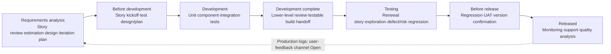

# Membership Renewal | One-Page Test Strategy (Format Example)

**Known example inputs:** release in two weeks; reduce renewal failures; timeout retries may cause duplicate charges; CI, staging, and production logs are available. Unconfirmed activities below are recommendations, not claims of completed work.

**Guiding principle:** The whole team owns quality.

**Goal:** Reduce renewal failures and keep charge results consistent with membership state.

### What to test | Functionality · Performance · Security

| Functionality | Performance | Security |
| --- | --- | --- |
| Priority: successful renewals, timeout retries, duplicate charges | Risk/scope Open | Risk/scope Open |

### Test enablers and constraints

CI, staging, and production logs are available; test data/access limits, automation/manual approach, tools, and team roles/capability are Open.

### How to test | Lifecycle and shift-left/right

Shift-left: clarify renewal rules and timeout behavior early. Shift-right: use observable production logs to track failures and duplicate charges. Confirm actual activities, owners, and release gates with the project.

### Test quadrants

|  | Supports the team | Evaluates the product |
| --- | --- | --- |
| Business-facing | **Q2** Renewal story/acceptance examples (rules to confirm) | **Q3** Timeout/retry exploration and UAT (recommended) |
| Technology-facing | **Q1** Unit/component/integration (existing coverage Open) | **Q4** Performance/load/security/reliability (risks Open) |

Automation/manual approach and tools are Open; quadrants are a selection map, not a requirement to invest equally in all four.

### Lean test layers

- Top: Exploratory testing—exercise timeout, retry, and state recovery in staging (recommended).
- Middle: API/integration testing—validate renewal requests, callbacks, and duplicate handling (interface details Open).
- Base: Unit testing—fast checks for renewal rules; CI is available, existing coverage Open.

### Iterations and feedback

Iteration 1 → Iteration 2 → … → n → Release/production; recommend selecting layers by renewal risk each round and feeding CI/staging results and production failure signals into the next round. User-feedback channel, cadence, support workflow, and gates are Open.

**Open questions:** Performance/security scope, test levels and tools, iteration cadence, release gates, production support owner, and other high-risk journeys.
