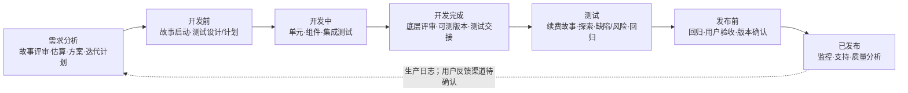

# 会员续费｜一页纸测试策略（格式示例）

**示例已知输入：** 两周后发布；目标是减少续费失败；风险是超时重试造成重复扣款；CI、预发和生产日志可用。下列未确认活动是策略建议，不代表已执行。

**指导性原则：** 团队共同负责质量。

**目标：** 减少续费失败，保持扣款结果与会员状态一致。

### 测什么｜功能 · 性能 · 安全

| 功能 | 性能 | 安全 |
| --- | --- | --- |
| 核心：续费成功、超时重试和重复扣款 | 风险/范围待确认 | 风险/范围待确认 |

### 测试使能与约束

CI、预发和生产日志可用；测试数据及访问限制、自动化/手动方式、工具、团队角色与能力待确认。

### 怎么测｜生命周期与左右移

左移：前置确认续费规则和超时行为；右移：用已可观测的生产日志跟踪失败与重复扣款。实际活动、负责人和发布门槛按项目确认。

### 测试象限

|  | 支持团队 | 评价产品 |
| --- | --- | --- |
| 面向业务 | **Q2** 续费故事/验收示例（规则待补） | **Q3** 超时重试探索/用户验收（建议） |
| 面向技术 | **Q1** 单元/组件/集成（现有覆盖待确认） | **Q4** 性能/负载/安全/可靠性（风险待确认） |

自动化/手动方式与工具待确认；四象限是选择地图，不表示四类都必须投入。

### 精益测试分层

- 上层：探索性测试——预发验证超时、重试和状态恢复（建议）。
- 中层：API/集成测试——验证续费请求、回调和重复处理（接口细节待确认）。
- 底层：单元测试——快速验证续费规则；CI 已知可用，现有覆盖待确认。

### 迭代与反馈

迭代 1 → 迭代 2 → … → n → 发布/生产；建议每轮按续费风险选择分层测试，并将 CI/预发结果和生产失败信号带入下一轮；用户反馈渠道、迭代周期、支持流程和门槛待确认。

**待确认：** 性能/安全范围、测试层级与工具、迭代节奏、发布门槛、生产支持负责人及其他高风险旅程。
